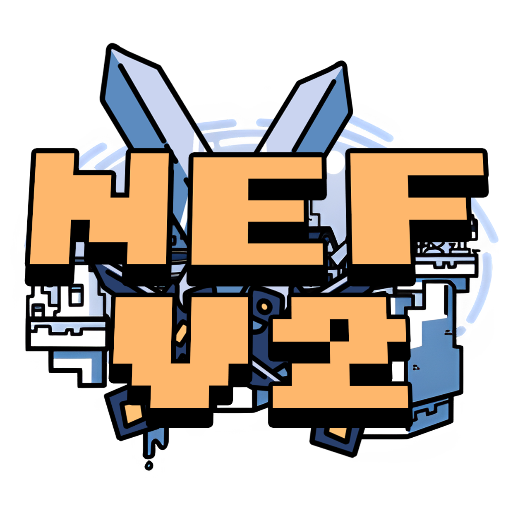

# NotEnoughFakepixel

This is a remaster of NotEnoughFakepixel mod from GinaFro.

    
     
    
    

## Minecraft versions

| Project | Mod loader | Build requirements | Status |
| --- | --- | --- | --- |
| [`1.8.9/`](1.8.9/) | Forge | JDK 17 for Gradle and a Java 8 toolchain | Existing mod with the features listed below |
| [`1.21.1/`](1.21.1/) | Fabric | JDK 21 | Configuration GUI available. Gameplay features are still being ported. |

Open either version folder as a Gradle project. From that folder, run `.\gradlew.bat build` on Windows or `bash ./gradlew build` on macOS or Linux. The JAR is written to that project's `build/libs/` directory.

In IntelliJ IDEA, open the repository folder to use the shared run configurations. If the Gradle tool window does not list both builds, import `1.8.9/build.gradle.kts` and `1.21.1/build.gradle.kts` as Gradle projects. Use each project's Gradle wrapper and set the Gradle JVM to JDK 21. Select **Forge 1.8.9 Client** or **Fabric 1.21.1 Client** in the Run dropdown. The first launch downloads the game's assets and runtime libraries.

If you open a version folder as its own project, run `runForgeClient` for Forge or `runClient` for Fabric from its Gradle tool window. Pass `-PdevAuth=true` for Microsoft sign-in.

For servers that require a signed-in account, select **Forge 1.8.9 Client (Microsoft Sign-In)** or **Fabric 1.21.1 Client (Microsoft Sign-In)**. Both configurations enable DevAuth. Open the Microsoft sign-in link from IntelliJ's Run console when prompted. Use the standard client configurations for local testing.

If DevAuth reports `No account specified` on first setup, uncomment `defaultAccount = "main"` in its `config.toml` and run the configuration again. On Windows that file is in `%USERPROFILE%\.devauth`.

In the 1.21.1 Fabric client, install **Fabric API** and open the configuration GUI with **P**, `/nef`, or `/notenoughfakepixel`. To open with a search, use a command such as `/nef Dungeons`. Settings are saved to `config/notenoughfakepixel.json` when the screen closes. The menu includes the legacy categories and editable settings. Gameplay features and their action buttons still need to be ported.

### Registering Fabric features

Add features under `com.nef.notenoughfakepixel` and use the annotations in `env.registers`.

- `@RegisterEvents` goes on a class that implements `ClientModInitializer`. Attach Fabric event callbacks in `onInitializeClient()`.
- `@RegisterCommand` goes on a class that implements `ClientCommandRegistrationCallback`. Add your commands in `register()`.
- `@RegisterKeybind` goes on an initialized static `KeyBinding` field.
- `@RegisterInstance` goes on an initialized static field holding a feature that implements either callback interface. Use it for singletons or constructors with arguments.

Classes registered directly need a no-argument constructor. [ClientConfig](1.21.1/src/main/java/com/nef/notenoughfakepixel/config/ClientConfig.java) shows how to register events, commands, and a keybind on one feature.

## License
This project is licensed under the GNU Lesser General Public License v3.0 or later (LGPL-3.0-or-later).
See the [LICENSE](LICENSE) file for details.

## Features

Use **X** for present features. Other statuses include **Pending**, **Needs rework**, and **Needs fixes**.

### Quality of life

| Subcategory | Feature | 1.8.9 | 1.21 |
| --- | --- | --- | --- |
| General | Alerts | X |  |
| General | Aliases | X |  |
| General | Disable block breaking particles | X |  |
| General | Always sprint | X |  |
| General | Copy chat message | X |  |
| General | Full block lever | X |  |
| General | Block placing items | X |  |
| General | Show unclaimed Jacob rewards | X |  |
| General | Fairy soul waypoints | X |  |
| General | Spider's den relic waypoints | X |  |
| General | Etherwarp overlay | X |  |
| General | Etherwarp sounds | X |  |
| General | Hide flaming fists | X |  |
| General | Hide player armor | X |  |
| General | Hide dead mobs | X |  |
| General | Hide falling blocks | X |  |
| General | Item animations | X |  |
| General | Smol people | X |  |
| General | Reforge helper | X |  |
| General | Disable Hyperion Explosions | X |  |
| General | Disable Thunderlord enchantment bolts | X |  |
| General | No Hurt camera animation | X |  |
| General | Golden enchants | X |  |
| General | Fullbright | X |  |
| General | Disable Potion Effects in inventory | X |  |
| General | Show current pet in pet menu | X |  |
| General | Storage overlay | X |  |
| General | Equipment overlay | X |  |
| General | Slot locking & binding | X |  |
| General | Middle click on Menus | X |  |
| General | Scrollable tooltips | X |  |
| General | Disable sounds from Jerry-chine gun and AOTE | X |  |
| General | Midas Staff minimal animation and sounds | X |  |
| General | Wardrobe key shortcut | X |  |
| General | Equipment key shortcut | X |  |
| General | Hide players close to NPCs  | X |  |
| General | Missing Accessories GUI  | X |  |
| General | Show Ender Nodes  | X |  |
| Chat | Disable Friend > joined messages | X |  |
| Chat | Disable Info & Watchdog messages | X |  |
| Chat | Disable selling ranks messages | X |  |

### Farming

| Feature | 1.8.9 | 1.21 |
| --- | --- | --- |
| 1.12 Crop height | X |  |

### Fishing

| Feature | 1.8.9 | 1.21 |
| --- | --- | --- |
| Fishing countdown | X |  |
| Fishing notifier for Legendary Sea Creatures | X |  |
| Notifier for Trophy Fishing | X |  |

### Dungeons

| Subcategory | Feature | 1.8.9 | 1.21 |
| --- | --- | --- | --- |
| General | Custom Leap GUI | X |  |
| General | Custom Terminal GUI | X |  |
| General | Blood ready title | X |  |
| General | Boulder Solver | X |  |
| General | Silverfish Solver | X |  |
| General | Wither doors highlight | X |  |
| General | Teleport maze Solver | X |  |
| General | Terminal waypoints | X |  |
| General | Custom S+ message | X |  |
| General | Spirit bow tracer | X |  |
| General | Dungeon Map | X |  |
| General | Three Weirdos Solver | X |  |
| General | Auto Ready | X |  |
| General | Auto close secret chests | X |  |
| General | "Unable to locate sign" hidden | X |  |
| General | S+ reminder | X |  |
| General | Score overlay | X |  |
| General | Secret overlay | X |  |
| Starred mobs | Starred mob display | X |  |
| Starred mobs | Fel position display | X |  |
| Starred mobs | Bat position display | X |  |
| Floor 7 | Terminal solvers | X |  |
| Floor 7 | Terminal tracker | X |  |
| Floor 7 | Box withers | X |  |
| Master Mode 7 | M7 dragon highlight | X |  |
| Master Mode 7 | M7 relic waypoints | X |  |

### Mining

| Subcategory | Feature | 1.8.9 | 1.21 |
| --- | --- | --- | --- |
| General | Drill Animation Reset FIX | X |  |
| General | Mining Ability ready notifier | X |  |
| General | Dwarven waypoints | X |  |
| Mining Overlay | Drill Fuel Overlay | X |  |
| Mining Overlay | Mining Ability cooldown Overlay | X |  |
| Mining Overlay | Commissions Overlay | X |  |
| Mining Overlay | Mithril Powder Overlay | X |  |
| Mining Overlay | Puzzler NPC Solver | X |  |
| Crystal Hollows  | Crystal Hollows Map  | X |  |
| Crystal Hollows  | Crystal Hollows Waypoints  | X |  |
| Crystal Hollows  | FullBlock glass panes  | X |  |
| Crystal Hollows  | Treasure Found notifier  | X |  |
| Crystal Hollows  | Precursor City Overlay  | X |  |
| Crystal Hollows  | Automaton Overlay  | X |  |
| Crystal Hollows  | Metal Detector Guesser  | X |  |
| Crystal Hollows  | Worm Notifier  | X |  |
| Crystal Hollows  | Mines of Divan Overlay  | X |  |

### Experimentation Table

| Feature | 1.8.9 | 1.21 |
| --- | --- | --- |
| Chronomatron solver | X |  |
| Ultrasequencer solver | X |  |
| Prevent missclicks | X |  |

### Chocolate Factory

| Feature | 1.8.9 | 1.21 |
| --- | --- | --- |
| Show best rabbit in Chocolate Factory | X |  |
| Hoppity's hunt eggs waypoints | X |  |
| New Egg notifier  | X |  |
| New Egg timer  | X |  |

### Crimson Isle

| Feature | 1.8.9 | 1.21 |
| --- | --- | --- |
| Bosses notifier | X |  |
| Ashfang helper & overlay | X |  |

### Diana

| Feature | 1.8.9 | 1.21 |
| --- | --- | --- |
| Burrow guess | X |  |
| Warp keybind | X |  |
| Burrow waypoints | X |  |
| Gaia construct helper | X |  |
| Syamese Lynx helper | X |  |
| Minos Inquisitor party chat & waypoint | X |  |
| Inquisitor Outline | X |  |
| Some QOL features | X |  |

### Slayers

| Feature | 1.8.9 | 1.21 |
| --- | --- | --- |
| Voidgloom Seraph beacon waypoint BETA | X |  |
| Miniboss spawn alert | X |  |
| Slayer health display | X |  |
| Slayer boss time | X |  |
| Blaze pillar title | X |  |
| Blaze attunements | X |  |

